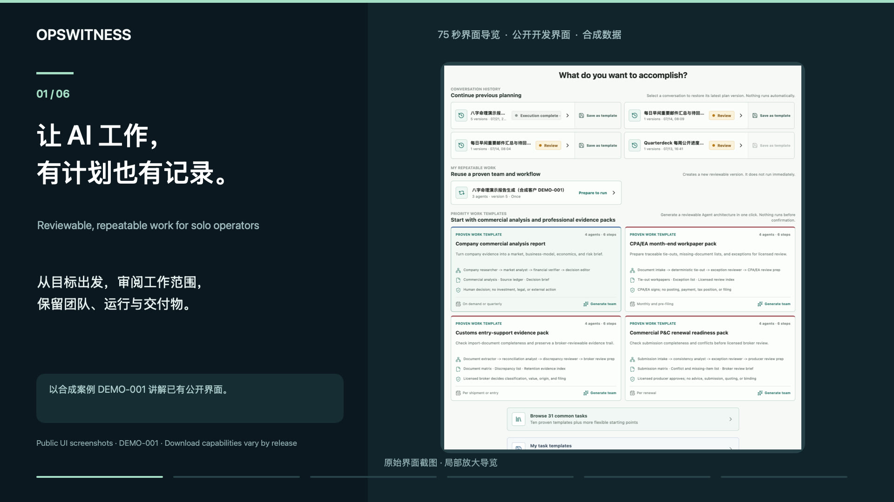
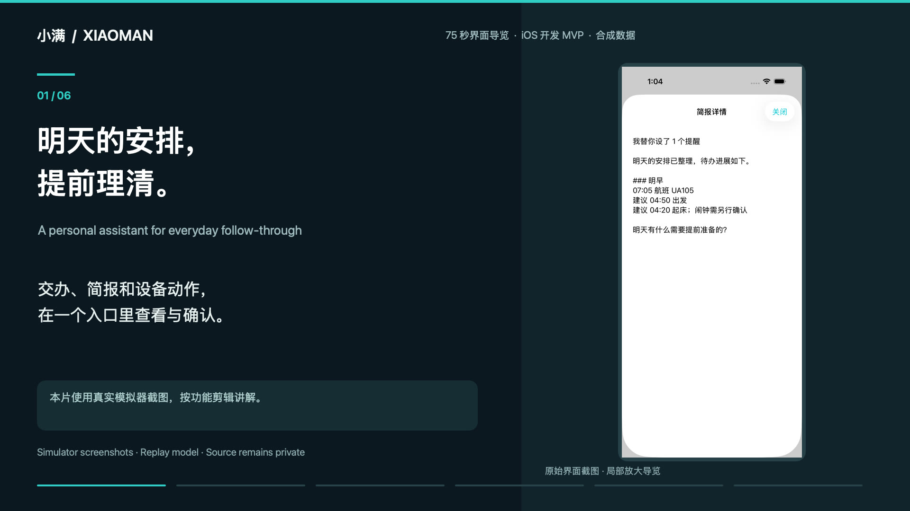

# Tianyu Zhou

I build practical AI products, from native apps to tools for repeatable work.

我关注 AI 产品、可靠的执行流程，以及从原型到可验证交付的工程实践。

## OpsWitness — repeatable AI work

**Creator & maintainer** · [GitHub](https://github.com/opswitness/opswitness) · [Website](https://opswitness.com/) · [Alpha release](https://github.com/opswitness/opswitness/releases/tag/v0.1.0-alpha.1)

A local-first AI workbench for solo operators: describe a goal, review the team and plan, confirm execution, and keep versions, results, approvals, and evidence together.

My work spans product direction, system architecture, runtime integration, validation, and release preparation. Technical areas include:

- Reviewable workflow plans and immutable versions.
- Human approvals, run history, and traceable outputs.
- Local evidence storage and replaceable execution adapters.

**Status:** Community Alpha. The published build and development source have different capabilities; the release notes describe the exact download and its limitations.

**[Watch the 75-second walkthrough](https://github.com/tianyurx/tianyurx/blob/main/opswitness-walkthrough-75s.mp4)** · 中文配音 / Chinese narration · [Scope and transcript](DEMO-NOTES.md#opswitness)

*Screenshot walkthrough, not a continuous screen recording. Public development UI, synthetic DEMO-001 case. Download capabilities depend on the release.*

## 小满 · Xiaoman — an iOS personal assistant

**Creator & developer** · Development MVP · Private implementation

小满把日历、提醒事项和随手记录汇集到一个入口，通过对话、主动汇报和用户确认来推进日常事务。

An iOS assistant that brings calendars, reminders, and captured ideas into one place. My focus is product design, SwiftUI/Python integration, synchronization, and user-confirmed actions with receipts and undo.

**Stack:** Swift / SwiftUI · Python / FastAPI · PostgreSQL

**Status:** Local simulator demonstrations and ongoing development. Real-account and on-device acceptance remain part of the work before a broader release.

**[Watch the 75-second walkthrough](https://github.com/tianyurx/tianyurx/blob/main/xiaoman-walkthrough-75s.mp4)** · 中文配音 / Chinese narration · [Scope and transcript](DEMO-NOTES.md#xiaoman)

*Screenshot walkthrough, not a continuous screen recording. iOS simulator, replay model and fake data. The alarm example shows the decline path; no real alarm was installed.*

## Quantitative research engineering

**Private research project**

I also develop multi-asset research infrastructure, with an emphasis on causal features, chronological validation, transaction costs, risk controls, and reproducible backtests.

## How I work

I use AI-assisted development alongside explicit specifications, code review, tests, and hands-on validation. I care about making behavior explainable and keeping prototype, tested, and released capabilities clearly distinguished.

